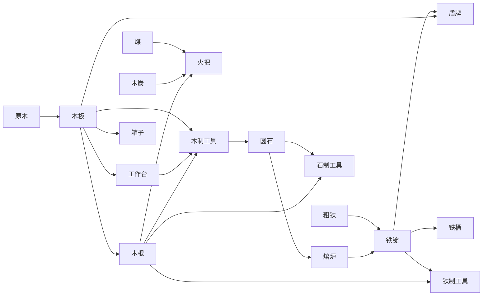

# 早期游戏合成图

`src/action/crafting-tree.js` 是早期阶段的单一配方来源。它把 Minecraft Wiki 中第一天常用的木材、石制工具、熔炉、照明、储物和铁制工具配方整理为有向无环图，并在运行时根据真实背包展开成合成树。

## 给 AI 的查询结果

`buildEarlyGameCraftingSnapshot(inventory)` 返回三个部分：

- `dag.nodes` 与 `dag.edges`：静态配方图，适合模型理解依赖关系。
- `targets`：默认评估工作台、木镐、石镐、熔炉、16 个火把、箱子、盾牌和铁桶。
- 每个目标的 `tree`、`ok` 与 `missing`：按当前背包消耗共享的木板、木棍和石料，避免把同一批材料重复计算。`kind: "smelt"` 表示必须安排熔炼；`missing` 的 `reason: "workstation"` 表示需要先准备工作台或熔炉。

需要评估其他目标时调用 `analyzeCraftingPlan(item, count, inventory)`。`inventory` 使用公开 API 的 `items` 结构，物品名可带 `minecraft:` 前缀。

配方依据： [Minecraft Wiki Crafting](https://minecraft.wiki/w/Crafting)、[Beginner's guide](https://minecraft.wiki/w/Tutorial:Beginner%27s_guide)、[Crafting/Tools](https://minecraft.wiki/w/Crafting/Tools)、[Crafting Table](https://minecraft.wiki/w/Crafting_Table)、[Pickaxe](https://minecraft.wiki/w/Pickaxe)、[Boat](https://minecraft.wiki/w/Spruce_Boat)。版本差异较大的进阶、下界和红石配方不在早期图中。

## 长期采矿的本地材料压缩（2026-11-15）

当前 C++ 执行器在空槽≤2且红石或青金石达到128个时，按实际库存每9个合成1个矿物块，遵循第三方服务每请求最多64次配方循环的限制，每批最多64块；保留余数与其他资源，整批完成后才回收临时工作台，并返回原施工点。支持反向拆解配方；不压缩钻石，以免干扰钻甲材料交接。背包完全满时清槽不受8次挖掘的维护间隔限制。自动工作站查找优先附近缓存与随身工作台，跳过未加载的旧设施且不隐式查询32格以外基地；用户明确指定设施坐标时仍报告真实错误。
